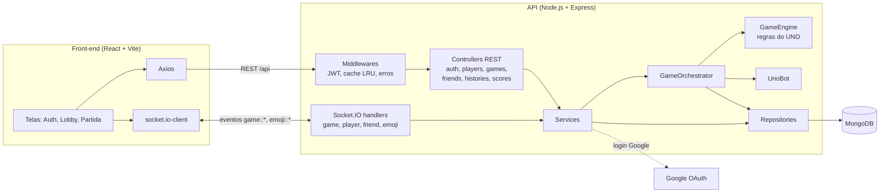

<h1>
  
  &nbsp;URRO — UNO Online com tema Shrek
</h1>

> UNO multiplayer em tempo real, direto do pântano: salas online, bots, chat, emotes e regras completas validadas no servidor.

<!-- TODO: gravar um GIF curto de uma partida e salvar em docs/demo.gif -->


## Sobre o projeto

O **URRO** é um jogo de UNO online com tema Shrek, desenvolvido em equipe como projeto de estudo. Os jogadores criam conta (ou entram com Google), abrem ou entram em salas, completam a mesa com bots e jogam em tempo real. O servidor é a fonte da verdade: todas as regras são validadas no back-end e o estado da partida é transmitido aos jogadores via Socket.IO.

Capturas de tela das principais telas estão em [`apresentation/`](apresentation/).

## Funcionalidades

- **Autenticação**: cadastro e login com senha (hash bcrypt), login com Google, sessão via JWT em cookie e logout com invalidação do token.
- **Salas de jogo**: criação com título, senha opcional e limite de até 4 jogadores; listagem, entrada, saída, sinal de "pronto" e início da partida.
- **Bots**: preenchimento de vagas com bots que usam uma heurística própria (priorizam cartas especiais quando o próximo jogador está perto de vencer, poupam coringas e escolhem a cor mais vantajosa).
- **Regras do UNO**: baralho completo de 108 cartas, 7 cartas por jogador, Pular, Inverter, +2, Coringa e +4 com escolha de cor, reabastecimento do monte, grito de "URRO" (UNO) e desafio com penalidade.
- **Tempo real**: jogadas, estado da mesa, chat da sala, emotes com som, contagem de jogadores online e convites de amigos via Socket.IO.
- **Reconexão**: o jogador que cai tem 60 segundos para voltar à partida.
- **Social e histórico**: sistema de amizades, histórico de partidas e registro de jogadas.
- **Configurações e acessibilidade**: efeitos sonoros, música, modo escuro, modo daltonismo e redução de animações.
- **Tema Shrek**: cartas customizadas, avatares de personagens (Shrek, Fiona, Burro, Gato de Botas), emotes e trilha sonora.

## Tecnologias

| Camada | Tecnologias |
|---|---|
| Back-end | Node.js, Express 5, Socket.IO, Mongoose, Zod, JWT, bcryptjs, Google Auth Library, Pino, Morgan |
| Front-end | React 19, TypeScript, Vite, TanStack Router, TanStack Query, Tailwind CSS 4, socket.io-client, Axios |
| Banco de dados | MongoDB 7 |
| Testes | Jest, Supertest, Babel |
| Infraestrutura | Docker, Docker Compose, ngrok (túnel opcional) |

## Arquitetura

Monorepo com cliente e servidor separados. O front-end (React + Vite) consome a API REST para autenticação, salas, amizades e histórico, e mantém uma conexão Socket.IO para tudo o que acontece durante a partida. Em desenvolvimento, o Vite faz proxy de `/api` e `/socket` para a API.

O back-end é organizado por domínio (`src/modules/<domínio>`) em camadas **Controller / Socket handler → Service → Repository → MongoDB**, com DTOs validados por Zod e injeção de dependências pelo construtor. As regras do UNO ficam em um motor puro (`GameEngine`), sem dependência de banco; o `GameOrchestrator` converte o documento persistido em estado do motor, aplica a jogada, persiste o resultado, registra o histórico, aciona os bots e dispara os eventos em tempo real.



Os eventos seguem o padrão `módulo::ação` (ex.: `game::play`, `game::info`, `emoji::send`). Documentação detalhada de arquitetura, modelagem de dados, middlewares, infraestrutura e eventos está em [`documents/`](documents/).

## Como executar

### Pré-requisitos

- Node.js 20.6 ou superior (a API usa a flag `--env-file`)
- Docker e Docker Compose (para o MongoDB) ou uma instância MongoDB própria

### 1. Banco de dados

```bash
cd source-code
docker compose up mongodb -d
```

Sobe o MongoDB na porta `27017`. As credenciais iniciais estão definidas em `source-code/docker-compose.yaml`.

### 2. API (porta 3000)

```bash
cd source-code/UnoShrekApi
cp env.exemple .env   # preencha as variáveis
npm install
npm start             # ou: npm run start::watch
```

| Variável | Descrição |
|---|---|
| `API_PORT` | Porta da API (padrão `3000`) |
| `MONGODB_USER`, `MONGODB_PASSWORD` | Usuário e senha do MongoDB |
| `MONGODB_HOST`, `MONGODB_PORT`, `MONGODB_NAME` | Host (`localhost` ou nome do container), porta (padrão `27017`) e nome do banco |
| `JWT_SECRET` | Segredo para assinar os tokens JWT |
| `FRONTEND_URL` | Origem permitida no CORS (ex.: `http://localhost:5173`) |
| `PROFILE` | `dev` ou `prod` (padrão `dev`) |
| `SOCKET_PATH` | Caminho do Socket.IO, usado apenas com `PROFILE=prod` |
| `GOOGLE_CLIENT_ID` | Client ID do Google OAuth |

<!-- TODO: GOOGLE_CLIENT_SECRET aparece em env.exemple mas não é lido pelo código; confirmar se pode ser removido. -->

### 3. Front-end (porta 5173)

```bash
cd source-code/UnoShrekFrontEnd
cp .env.example .env  # preencha as variáveis
npm install
npm run dev
```

| Variável | Descrição |
|---|---|
| `VITE_PROFILE` | `dev` ou `prod` |
| `VITE_API_URL` | URL base da API (vazio = usa o proxy do Vite) |
| `VITE_API_PREFIX` | Prefixo das rotas REST (`/api`) |
| `VITE_SOCKET_PREFIX` | Prefixo do Socket.IO (`/socket`) |
| `VITE_BACKEND_URL` | Endereço da API para o proxy (ex.: `http://localhost:3000`) |
| `VITE_GOOGLE_CLIENT_ID` | Client ID do Google OAuth |

Acesse `http://localhost:5173`.

### Alternativa: tudo com Docker Compose

```bash
cd source-code
docker compose up -d
```

Sobe MongoDB, API, front-end e um túnel ngrok. Requer os arquivos `.env` da API e do front-end e um `source-code/.env` com `NGROK_AUTHTOKEN` (veja `source-code/.env.example`).

<!-- TODO: confirmar se a stack completa via Docker Compose funciona sem o serviço ngrok/token. -->

## Como rodar os testes

Os testes estão na API (`source-code/UnoShrekApi/test`):

```bash
cd source-code/UnoShrekApi
npm test                 # testes unitários
npm run test::coverage   # unitários com relatório de cobertura
npm run test::e2e        # testes E2E (requer .env configurado e MongoDB rodando)
```

<!-- TODO: incluir o percentual de cobertura após rodar npm run test::coverage. -->

## Minha contribuição

Rodrigo Arraes. Principais entregas, segundo o histórico do Git:

- **Implementei** cadastro de jogador com senha (hash bcrypt) e a validação de credenciais no login.
- **Implementei** o controller e completei o service de pontuação dos jogadores (score).
- **Escrevi** mais de 1.200 linhas de testes unitários cobrindo autenticação, login, `GameService` e `GameOrchestrator` (compra, jogada, pronto/não pronto e demais métodos).
- **Adicionei** um delay de "pensamento" e o broadcast em tempo real de cada jogada dos bots.
- **Corrigi** o fluxo de jogo para que a jogada do humano seja respondida antes do processamento dos turnos dos bots.
- **Tornei** a senha da sala opcional, permitindo salas públicas.
- **Desenvolvi** de ponta a ponta o avatar de perfil: foto da conta Google ou personagem padrão (Shrek, Fiona, Burro, Gato de Botas), exibido no lobby, na sala de espera e na mesa.
- **Experimental (fora da main):** na branch [`lab/api-tracking-middleware`](https://github.com/RodrigoArraes07/uno-shrek-online/tree/lab/api-tracking-middleware), **criei** um middleware Express que registra no MongoDB o endpoint, o método, o status, o tempo de resposta e o usuário de cada requisição, além de 4 endpoints autenticados de estatísticas (requisições por método, tempos de resposta, distribuição de status codes e endpoints mais usados), com testes unitários.

## Equipe

- Davi Correia de Oliveira
- Kauã Henrique Gonçalves
- Pedro Lucas Farias de Melo
- Rodrigo Arraes

## Licença

Projeto disponibilizado apenas para fins educacionais e de estudo, sem uso comercial. Veja [LICENSE](LICENSE).
